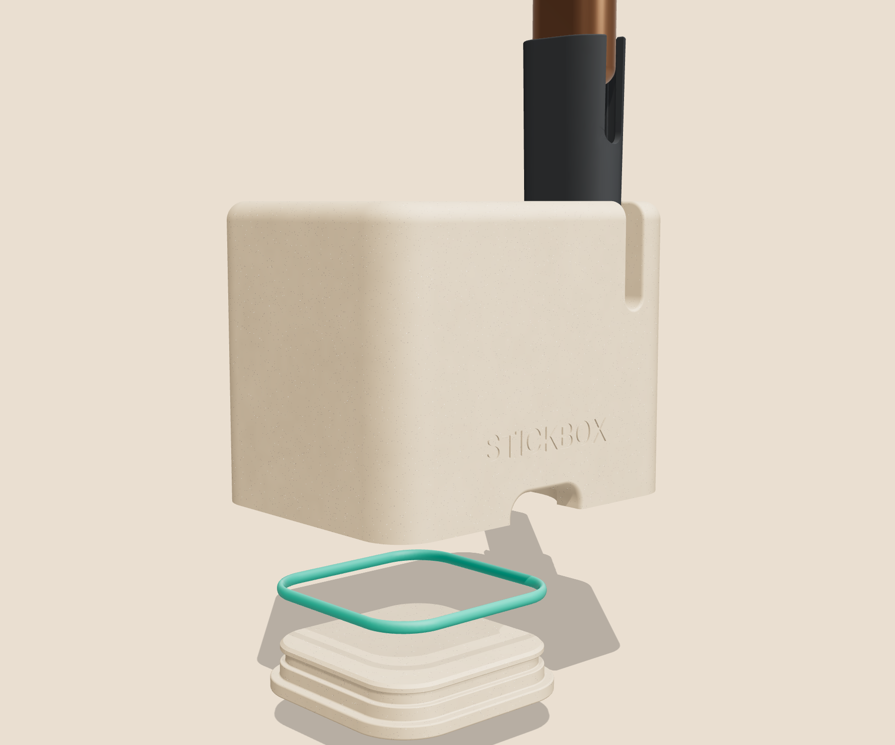
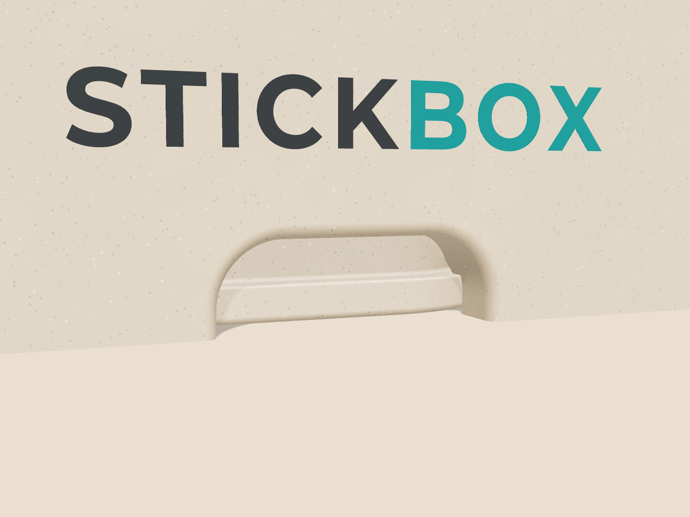

# STICKBOX 01 Monolith — інженерний пакет (ревізія v2.4)

Контейнер для використаних стіків TEREA / HEETS із тримачем IQOS ILUMA ONE. Корпус і кришка — з декоративного бетону,
відливаються в силіконові форми. Пакет містить параметричну CAD-модель, файли для друку оснащення, креслення,
розрахунки й документацію для запуску у виробництво. Перед серією обов'язкові пробні виливки і випробування прототипу
(`docs/08`).


| | |
|---|---|
|  |  |
|  |  |

## Ключові характеристики

| Параметр | Значення |
|---|---|
| Габарити | 120 × 90 × 95 мм (з девайсом — 133 мм) |
| Бетон на комплект | ≈489 мл (корпус 441 + кришка 47); було 636 мл у v2.3 |
| Маса комплекту без девайса | **0.90 кг при ρ 1800** (ціль 700–900 г); 0.95 кг при 1900; 1.00 кг при 2000 — див. `docs/01` §4 |
| Порожнина | 336 мл (з лотком кришки); ≈52 стіків без струшування / ≈58 зі струшуванням (симуляція MuJoCo, 8 прогонів) |
| Отвір | Ø8, пряма ділянка 2 мм; воронка Ø22; допустимий нахил стіка 15° (TEREA) / 11.8° (HEETS) |
| Тримач девайса | Кишеня 22.2 × 36.4 × 86.6 + знімна силіконова вставка; девайс не торкається бетону |
| Кришка | Пробка-лоток із губчастим силіконовим шнуром Ø4 (стиснення 27.5%, оцінка сили зняття 7–34 Н), без замків; виїмка 30 × 9.5 в корпусі; перекіс без заклинювання до 8° |
| Стійкість | Кут перекидання 41° з девайсом |
| Полегшення | Порожнина 23 × 31 у правій колонці, відкрита лише знизу (`RELIEF_ON`) |

## Структура

```
cad/                      параметрична модель (Python, CadQuery/OpenCASCADE)
  stickbox/params.py      ЄДИНЕ джерело розмірів, кожен параметр зі статусом і джерелом
  stickbox/parts.py       деталі виробу
  stickbox/molds.py       оснащення (майстри, гільзи, сердечник, форми кришки й вставки, калібри)
  stickbox/analysis.py    перевірки: маси, перетини, зазори, товщини, ухили, піднутрення, прохідність стіка, стійкість
  stickbox/capacity_sim.py  фізична симуляція місткості (MuJoCo)
  build_all.py            експорт усього пакета  ·  make_drawings.py  креслення  ·  make_reports.py  протокол
  cost.py                 калькулятор собівартості  ·  render/  рендер-конвеєр (three.js + Chromium)
exports/step|stl|3mf|glb  деталі виробу + збірка (STEP зі збіркою, назвами, кольорами)
tooling/step|stl|3mf      оснащення T01–T17 (STL/3MF уже орієнтовані для друку)
drawings/                 6 аркушів A3 (SVG) + зведений PDF
renders/                  фотореалістичні рендери, розрізи, оснащення, варіанти CMF
reports/                  analysis.json, geometry_protocol.md, capacity_sim*.json, independent_audit.md
docs/                     документація (нижче)
```

## Документація

| Документ | Зміст |
|---|---|
| [01_design_rationale](docs/01_design_rationale.md) | Функціональна архітектура, розглянуті альтернативи, відхилення від v2.2 і їх причини, CMF |
| [02_specification_bom](docs/02_specification_bom.md) | Усі параметри зі статусом, похідні розміри, специфікація (BOM), характеристики |
| [03_engineering_analysis](docs/03_engineering_analysis.md) | Перевірені дані з джерелами, прохідність стіка, місткість, ущільнення, литтєпридатність, міцність, безпека |
| [04_mold_making](docs/04_mold_making.md) | Друк і обробка майстрів, виготовлення силіконових форм, сердечника, форми вставки, калібрування усадки |
| [05_production_tech_card](docs/05_production_tech_card.md) | Склад суміші (орієнтири), операції, контроль якості, дефекти лиття, повторюваність |
| [06_cost_estimate](docs/06_cost_estimate.md) | Собівартість: кількості з CAD × ціни-припущення (редагуються в `cad/cost.py`) |
| [07_user_guide](docs/07_user_guide.md) | Складання, використання, спорожнення, догляд, застереження |
| [08_prototype_test_program](docs/08_prototype_test_program.md) | 12 випробувань прототипу з критеріями прийняття |
| [09_audit](docs/09_audit.md) | Самоаудит і незалежний аудит (4 критичні знахідки виправлено), відкриті ризики |
| [geometry_protocol](reports/geometry_protocol.md) | Протокол перевірки геометрії (генерується з моделі) |

## Як перебудувати

```bash
python3 -m venv /opt/cadenv && /opt/cadenv/bin/pip install cadquery trimesh numpy scipy shapely manifold3d rtree mujoco
cd cad
/opt/cadenv/bin/python build_all.py        # STEP/STL/3MF/GLB + оснащення + аналіз (~1 хв)
/opt/cadenv/bin/python make_drawings.py    # креслення SVG
/opt/cadenv/bin/python make_reports.py     # протокол + специфікація
/opt/cadenv/bin/python cost.py             # собівартість
/opt/cadenv/bin/python -m stickbox.capacity_sim ../reports/capacity_sim.json   # симуляція (~12 хв)
cd render && npm i three@0.160.0 && node render.js glb/shots.json ../../renders && node svg2pdf.js ../../drawings ../../drawings/STICKBOX_01_Monolith_drawings_A3.pdf
```

Будь-яку зміну розміру вносять у `cad/stickbox/params.py`. Решта (деталі, оснащення, креслення, звіти) перебудовується автоматично.

## Статус перевірки

* **Перевірено за джерелами:** габарит і маса ILUMA ONE (iqos.com), HEETS Ø7.42 × 45 (FDA), правила ущільнень
  (Parker, Trelleborg), усадка й властивості GRC (ACI, GRCA), усадка платинового силікону (Smooth-On, Wacker).
* **Перевірено розрахунком на моделі:** валідність B-Rep усіх тіл, замкнутість сіток, відсутність перетинів, зазори,
  товщини, ухили й піднутрення, узгодженість ливарної системи (0.03%), прохідність стіка, місткість (симуляція), стійкість.
* **Потребує прототипу:** густина суміші (маса), усадка й коефіцієнт масштабу, сила зняття/утримання кришки (губка),
  прохідність використаних стіків, місткість, стійкість тонких елементів до сколів, ресурс форм. Програма — `docs/08`.
* **Агенти:** окремий агент-дослідник перевіряв розміри й норми за першоджерелами. Окремий агент-аудитор незалежно
  перевіряв модель і оснащення (`reports/independent_audit.md`): 4 критичні та 9 серйозних знахідок, рішення — `docs/09`.
  Інші ролі з брифу окремими агентами не запускались; ці розділи виконано в основному потоці.
