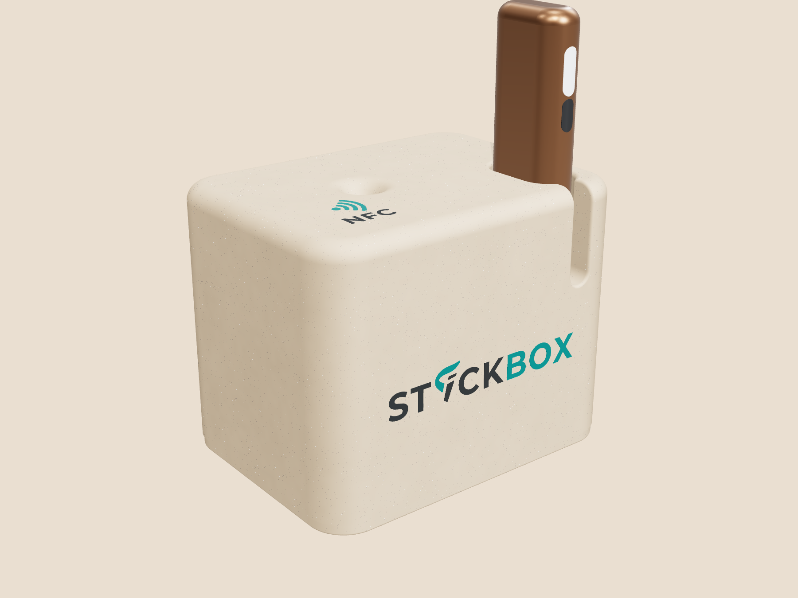
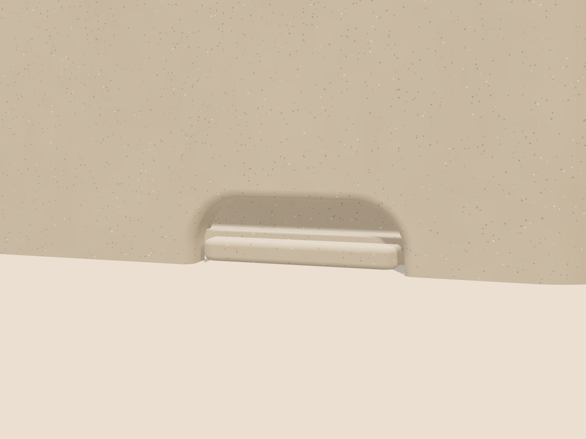
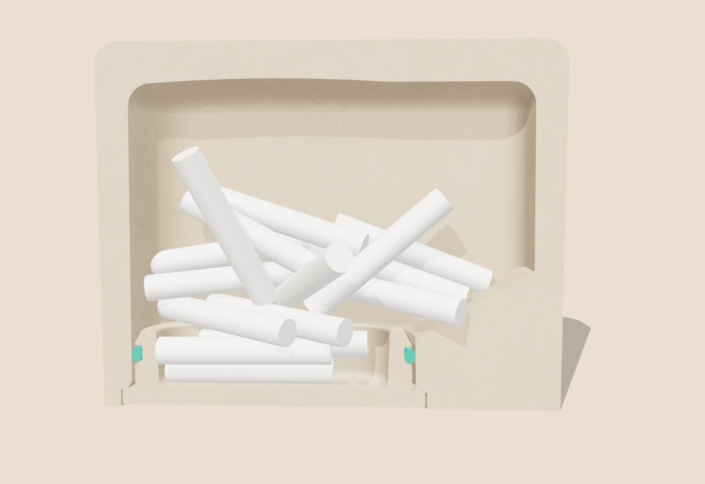
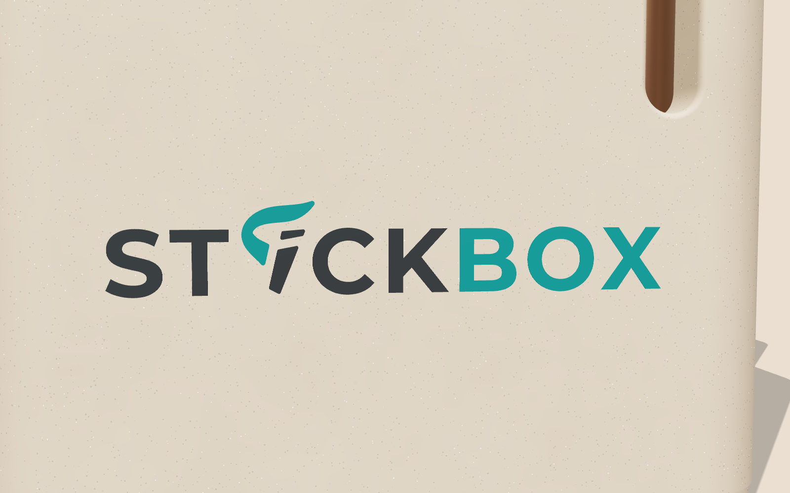
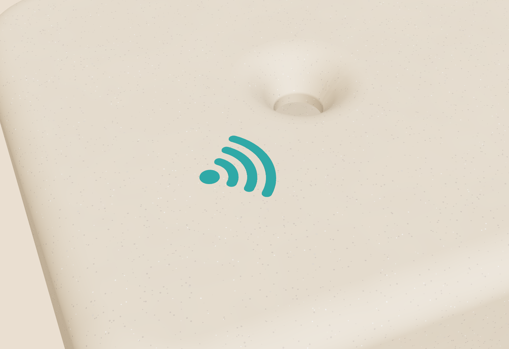
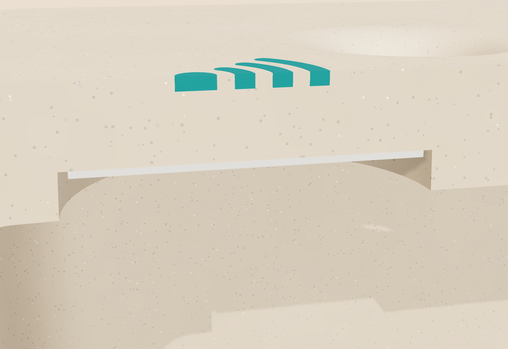
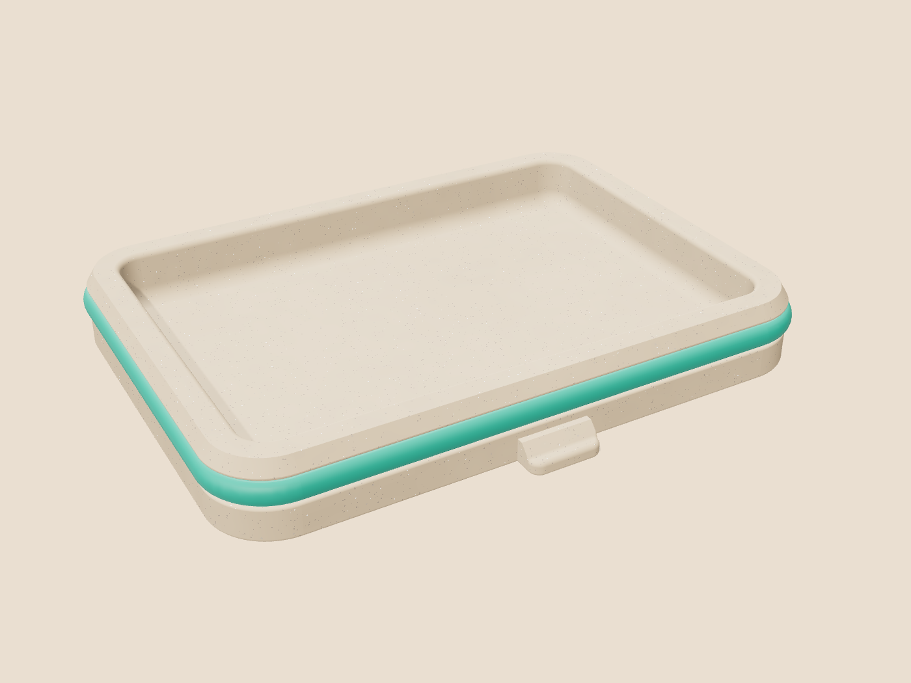
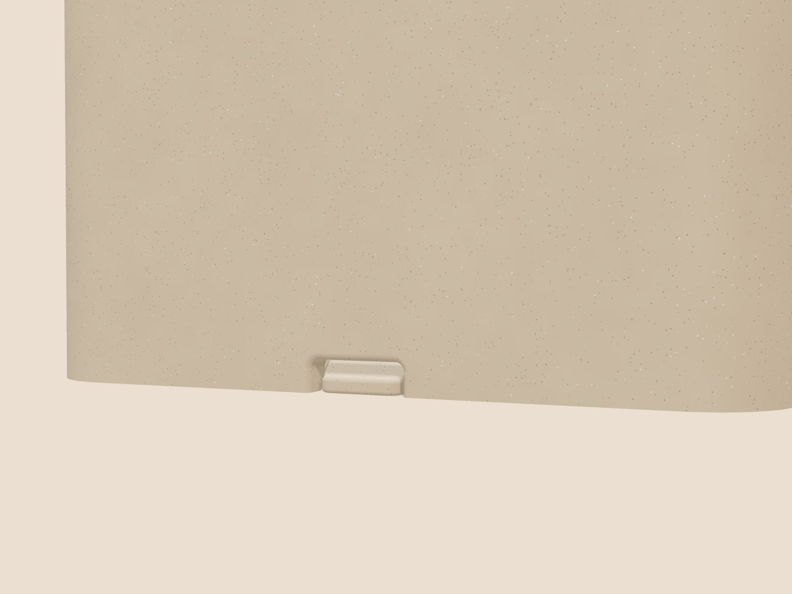

# STICKBOX 01 Monolith — інженерний пакет (ревізія v3.7.1)

Контейнер для використаних стіків TEREA / HEETS із тримачем IQOS ILUMA ONE. Корпус і кришка — з декоративного бетону,
відливаються в силіконові форми. Пакет містить параметричну CAD-модель, файли для друку оснащення, креслення,
розрахунки й документацію для запуску у виробництво. Перед серією обов'язкові пробні виливки і випробування прототипу
(`docs/08`).



| | |
|---|---|
|  |  |
|  |  |
|  |  |
|  |  |
|  |  |
|  |  |

## Ключові характеристики

| Параметр | Значення |
|---|---|
| Габарити | 120 × 90 × 95 мм (з девайсом — 143 мм) |
| Бетон на комплект | **≈382 мл** (корпус 328 + кришка 53); v3.4 — 438 мл, v3.3 — 494 мл, v2.3 — 636 мл. Стінки 5 мм (фронт 5.5) по всій висоті, кришка схована в дні — `docs/12` §9 |
| Маса комплекту без девайса | **0.65 кг при ρ 1700**, 0.67 кг при ρ 1750, 0.69 кг при ρ 1800, 0.77 кг при ρ 2000; полегшена суміш ρ 1600 — 0.61 кг (`docs/12` §9) |
| Резервуар | **Г-подібний, 514 мл** над кришкою (основна частина 437 + частина за тримачем 77), одна схована кришка; **≈74 стіки без струшування / ≈80 зі струшуванням** (MuJoCo, 4 прогони, геометрія v3.7; діапазони 61–80 / 67–89; обмежує купа під отвором) — `docs/12` §9 |
| Отвір | Ø8, пряма ділянка 2 мм; воронка Ø22; допустимий нахил стіка 15° (TEREA) / 11.8° (HEETS) |
| Тримач девайса | Овальна кишеня (стадіон) 18.8 × 33.0 × 75.5 під овальний девайс, ухил 0.5°, без вставки; на дні — повстяна підкладка 2 мм на клеї; девайс виступає на **48 мм** (v3.7) |
| Проріз-вітрина | 8 × 34 на фронті; кнопка і світлова смужка девайса — повністю над корпусом |
| Низ | **Кришка схована в дні** (v3.7): стінки моноліту стоять на площині опори, низ кришки урівень з ними; язичок кришки — у виїмці 15 × 5 на задній грані |
| Логотип | Напис STICKBOX (Montserrat Bold, великі літери 9 мм, ширина 78 мм), **літера I — фірмовий знак** (стік-i + хвиля над рядком); окремого знака немає (v3.2). Заглиблення 1.0 мм під заливку фарбою після виготовлення (прев'ю: STICK — RAL 7016, хвиля і BOX — бірюзовий); контури — плавні B-сплайни |
| Кришка | Прямокутний лоток 108.2 × 77.7 × **14 мм** без фланця, зі шнуром-губкою Ø4 (прямокутна петля над виїмкою, відріз 338 мм, стиснення 27.5%, оцінка сили витягування 9–44 Н), без замків; язичок 13 мм (σ 2.8 МПа при 30 Н); перекіс без заклинювання до 12° (`docs/12` §9) |
| NFC | Мітка Ø25 клеїться зсередини в кишеню стелі (над нею 6 мм бетону); знак NFC (крапка + 3 дуги, без напису) — на верху ліворуч-спереду від отвору, той самий дебосинг під фарбу; зчитування — тест Т22 |
| Стійкість | Кут перекидання 40° з девайсом; бічна сила на верх девайса, що нахиляє виріб, — 2.2 Н (ρ 1700) … 2.5 Н (ρ 2000), перевірка Т7 (`docs/12` §9) |
| Полегшення | Окремих порожнин і кришечок немає: v3.5 прибрала ребейт, поріг, рампу й порожнину полегшення; v3.6 — бетон колонки нижче гнізда пробки |
| Перевірка оснащення | **Віртуальне лиття** (v3.7.1): бетон «залито» між STEP-файлами форм. Виливок збігається з CAD виробу (99.9% поверхні в межах 0.005 мм); резервуар 514.2 мл, кишеня 75.5 мм, отвір Ø8.000, гніздо 110 × 79.5; девайс, кришка й шнур (27.5%) сідають; сердечник і форма знімаються без піднутрень. **51 PASS · 3 WARN · 0 FAIL**; знайдено й виправлено 2 хиби стику отвору — `docs/15` |

## Структура

```
cad/                      параметрична модель (Python, CadQuery/OpenCASCADE)
  stickbox/params.py      ЄДИНЕ джерело розмірів, кожен параметр зі статусом і джерелом
  stickbox/parts.py       деталі виробу
  stickbox/brand.py       напис і знак-I: трасування знака → плавні B-сплайни, розкладка напису → тіла дебосингу та маски фарб
  fonts/                  Montserrat Bold (SIL OFL 1.1) для напису
  stickbox/molds.py       оснащення (майстри, гільзи, Г-подібний сердечник, форма кришки, калібри)
  stickbox/analysis.py    перевірки: маси, перетини, зазори, товщини, ухили, піднутрення, прохідність стіка, стійкість
  stickbox/capacity_sim.py  фізична симуляція місткості (MuJoCo)
  stickbox/casting_check.py віртуальне лиття: бетон між файлами оснащення → порівняння з проєктом, проміри, посадки, виймання, повітря
  run_tests.py            повний набір перевірок (PASS / WARN / FAIL) → reports/test_results.json, docs/15
  build_all.py            експорт усього пакета  ·  make_drawings.py  креслення  ·  make_reports.py  протокол
  cost.py                 калькулятор собівартості  ·  render/  рендер-конвеєр (three.js + Chromium)
exports/step|stl|3mf|glb  деталі виробу + збірка (STEP зі збіркою, назвами, кольорами)
tooling/step|stl|3mf      оснащення T01–T10 (T02, T09 — розбірні каркаси з 2 половин), T13, T14, T17 (STL/3MF уже орієнтовані для друку)
tooling/print/            столи для слайсера 256 × 256 (Bambu / Orca): P1–P5 — FDM PETG, R1–R2 — смола, README
drawings/                 7 аркушів A3 (SVG) + зведений PDF (аркуш 07 — артворк напису зі знаком-I, схема фарбування)
renders/                  фотореалістичні рендери, розрізи, оснащення, варіанти CMF
renders/video/            анімація виготовлення (MP4, 1280 × 720) — запис сторінки viewer/process.html
reports/                  analysis.json, casting_verification.json, test_results.json, geometry_protocol.md, capacity_sim*.json, independent_audit.md
docs/                     документація (нижче)
```

## Документація

| Документ | Зміст |
|---|---|
| [01_design_rationale](docs/01_design_rationale.md) | Функціональна архітектура, розглянуті альтернативи, відхилення від v2.2 і їх причини, CMF |
| [02_specification_bom](docs/02_specification_bom.md) | Усі параметри зі статусом, похідні розміри, специфікація (BOM), характеристики |
| [03_engineering_analysis](docs/03_engineering_analysis.md) | Перевірені дані з джерелами, прохідність стіка, місткість, ущільнення, литтєпридатність, міцність, безпека |
| [04_mold_making](docs/04_mold_making.md) | Друк і обробка майстрів, виготовлення силіконових форм, сердечника, форми вставки, калібрування усадки |
| [05_production_tech_card](docs/05_production_tech_card.md) | Склад суміші (орієнтири), операції, контроль якості, дефекти лиття, повторюваність |
| [06_cost_estimate](docs/06_cost_estimate.md) | Собівартість: кількості з CAD × ціни-припущення (редагуються в `cad/cost.py`) |
| [07_user_guide](docs/07_user_guide.md) | Складання, використання, спорожнення, догляд, застереження |
| [08_prototype_test_program](docs/08_prototype_test_program.md) | 15 випробувань прототипу з критеріями прийняття |
| [09_audit](docs/09_audit.md) | Самоаудит і незалежний аудит (4 критичні знахідки виправлено), відкриті ризики |
| [11_wall_mass_audit](docs/11_wall_mass_audit.md) | v3.4: аудит товщини стінок і маси — чому було 7.5 мм, стінки 5 мм (міцність, лиття, усадка, виймання сердечника), порожнина полегшення, що ще можна, маса за густинами |
| [10_L_reservoir](docs/10_L_reservoir.md) | v3.0: Г-подібний резервуар під однією кришкою — обмеження ущільнювача, геометрія, міцність, виймання сердечника, місткість, маса й собівартість |
| [12_full_lid_rect_seal](docs/12_full_lid_rect_seal.md) | v3.5–v3.7: кришка на всю основу → прямокутна пробка й шнур → кришка схована в дні (14 мм, язичок 15 × 5), виступ девайса 48 мм — варіанти, перевірки, маса, стійкість, тести |
| [13_mold_maker_brief](docs/13_mold_maker_brief.md) | **ТЗ для виробника силіконових форм** (v3.7): що виготовити, склад пакета, вимоги до майстрів і силікону, порядок і критичні елементи кожної форми, приймання, що вказати в пропозиції. PDF + ZIP з файлами — `handoff/` |
| [14_mold_frame](docs/14_mold_frame.md) | v3.7: розбірний каркас силіконових форм (T02a/b, T09a/b) — рівновіддалений силікон без тонких стінок, ключі, обручі, болти; розрахунок товщини силікону, прогину й зусиль; використання при заливці силікону та литті бетону |
| [15_virtual_casting_tests](docs/15_virtual_casting_tests.md) | **v3.7.1: віртуальне лиття і повний набір перевірок.** Бетон «заливається» між STEP-файлами оснащення; виливок порівнюється з CAD виробу, міряються резервуар, кишеня, гніздо, отвір; перевіряються посадки девайса, кришки й шнура, виймання з форм, пастки повітря, люфти. Таблиця PASS / WARN / FAIL і знайдені й виправлені хиби стику отвору |
| [geometry_protocol](reports/geometry_protocol.md) | Протокол перевірки геометрії (генерується з моделі) |

## Як перебудувати

```bash
python3 -m venv /opt/cadenv && /opt/cadenv/bin/pip install cadquery trimesh numpy scipy shapely manifold3d rtree mujoco fonttools markdown
cd cad
/opt/cadenv/bin/python build_all.py        # STEP/STL/3MF/GLB + оснащення + аналіз (~1 хв)
/opt/cadenv/bin/python make_drawings.py    # креслення SVG
/opt/cadenv/bin/python make_reports.py     # протокол + специфікація
/opt/cadenv/bin/python cost.py             # собівартість
/opt/cadenv/bin/python render_prep.py      # GLB для рендерів (оснащення, розрізи, стіки)
/opt/cadenv/bin/python make_viewer_glb.py  # модель для веб-переглядача viewer/ (і для анімації виготовлення)
/opt/cadenv/bin/python make_tooling_plates.py  # столи для слайсера: tooling/print/*.3mf
/opt/cadenv/bin/python -m stickbox.capacity_sim ../reports/capacity_sim.json   # симуляція (~12 хв)
cd render && npm i three@0.160.0 && node render.js glb/shots.json ../../renders && node svg2pdf.js ../../drawings ../../drawings/STICKBOX_01_Monolith_drawings_A3.pdf
cd .. && /opt/cadenv/bin/python run_tests.py   # віртуальне лиття + усі перевірки (~10 хв), код 1 при FAIL
/opt/cadenv/bin/pip install markdown && /opt/cadenv/bin/python make_handoff.py   # ТЗ (PDF) + архів для виробника форм → handoff/
```

Будь-яку зміну розміру вносять у `cad/stickbox/params.py`. Решта (деталі, оснащення, креслення, звіти) перебудовується автоматично.

## Статус перевірки

* **Перевірено за джерелами:** габарит і маса ILUMA ONE (iqos.com), HEETS Ø7.42 × 45 (FDA), правила ущільнень
  (Parker, Trelleborg), усадка й властивості GRC (ACI, GRCA), усадка платинового силікону (Smooth-On, Wacker).
* **Перевірено розрахунком на моделі:** валідність B-Rep усіх тіл, замкнутість сіток, відсутність перетинів, зазори,
  товщини, ухили й піднутрення, узгодженість ливарної системи (0.03%), прохідність стіка, місткість (симуляція), стійкість.
* **Потребує прототипу:** густина суміші (маса), усадка й коефіцієнт масштабу, сила зняття/утримання кришки (губка),
  прохідність використаних стіків, місткість, стійкість тонких елементів до сколів, ресурс форм. Програма — `docs/08`.
* **Агенти:** окремий агент-дослідник перевіряв розміри й норми за першоджерелами. Окремий агент-аудитор незалежно
  перевіряв модель і оснащення (`reports/independent_audit.md`): 4 критичні та 9 серйозних знахідок, рішення — `docs/09`.
  Інші ролі з брифу окремими агентами не запускались; ці розділи виконано в основному потоці.

## Інтерактивний 3D-перегляд

`viewer/index.html` — інтерактивний симулятор моделі (three.js): обертання, знімання кришки анімацією, розріз зі стіками
з фізичної симуляції, розбирання на деталі, варіанти CMF, форми для лиття корпусу й кришки (каркас, силікон, сердечник, виливок).
`viewer/process.html` — анімація виготовлення (19 етапів: каркас → силікон → сердечник → бетон → розпалублення →
форма кришки → доводка → збирання), з розрізом і рівнями заливки; відео — `renders/video/` (запис: `cad/render/record_process.js`,
потрібен three@0.147.0, шлях — змінна `THREE_DIR`). Модель — `viewer/stickbox.glb.b64.txt` (GLB у base64,
згенерований з CAD). Для локального перегляду відкрийте папку через будь-який статичний вебсервер
(`python3 -m http.server` у `viewer/`).
