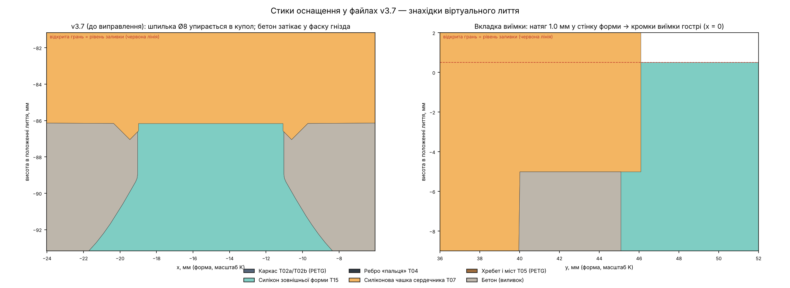
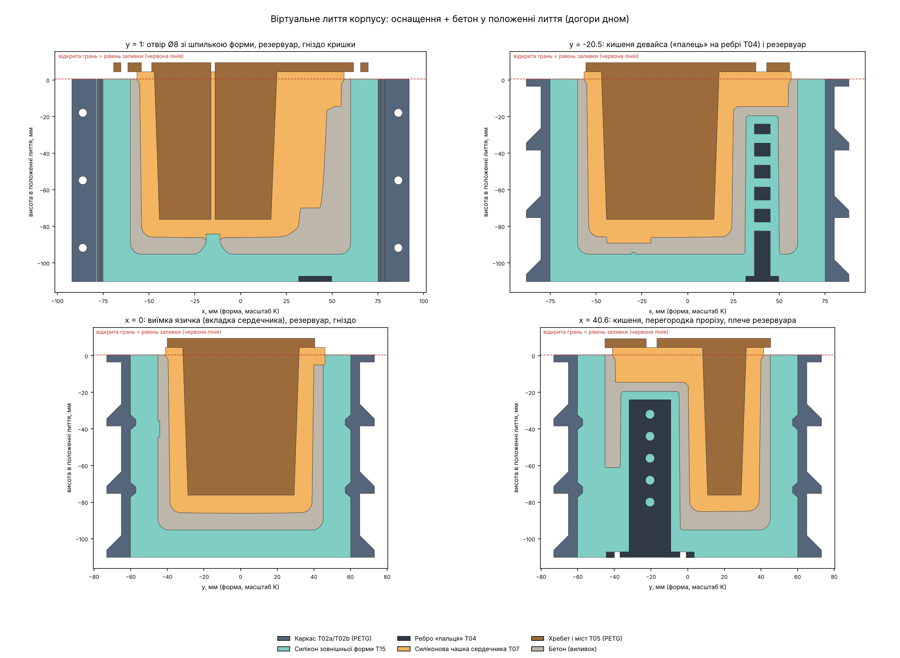
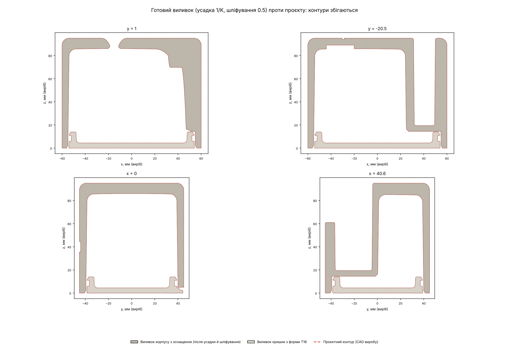
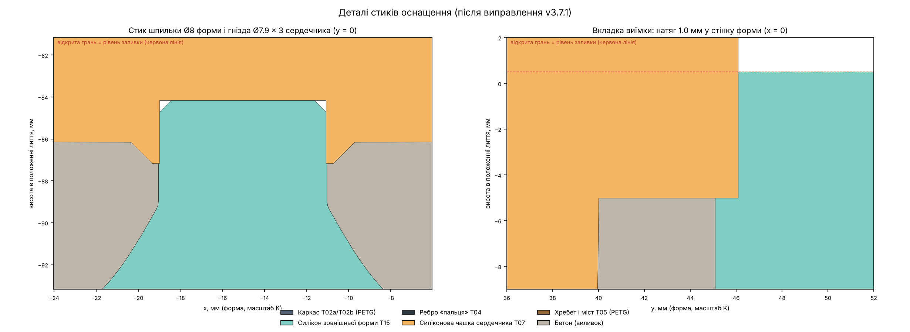
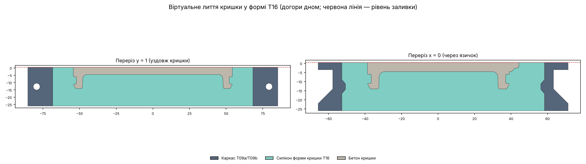

# 15. Віртуальне лиття і повний набір перевірок (v3.7.1)

Питання: **чи вийде з форм повноцінний виріб** — з резервуаром, кишенею девайса, гніздом і кришкою, що відповідають кресленню? Перевіряли не саму модель виробу, а **те, що дадуть файли оснащення**, які отримує виробник форм (`tooling/step`).

## Як перевірено

1. STEP-файли оснащення поставлено в положення лиття:
    * силікон зовнішньої форми T15 у каркасі T02a/T02b;
    * силіконова чашка сердечника T07 на хребті з мостом T05;
    * ребро «пальця» T04.
2. **Бетоном заповнено весь вільний простір** до площини заливки (відкритої грані). Заповнюється лише те, що з нею з'єднане.
3. Виливок зменшено на усадку (1/K, K = 1.002) і зішліфовано припуск 0.5 мм знизу.
4. Отриманий корпус:
    * порівняно з CAD виробу — булеві різниці об'ємів і відхилення поверхні в 30 000 точках;
    * проміряно променями (гніздо, резервуар, кишеня, отвір, проріз, виїмка);
    * у нього вставлено девайс, литу кришку (відлиту так само з форми T16) і шнур.
5. **Виймання:** кожну грань виливка віднесено до інструмента, що її формує. Для кожної грані перевірено, чи заважає щось інструменту вийти: сердечнику — вниз, зовнішній формі — вгору.
6. **Заповнення:** перевірено найвужчий проміжок між сердечником і формою, також зі зсувом сердечника на люфт шпильок; «стелі», під якими збирається повітря; силу, з якою бетон виштовхує сердечник.

Це геометричні розрахунки на CAD-моделях, а не фізичне лиття. Поведінку суміші (текучість, усадку, бульбашки) підтверджують пробні виливки.

## Підсумок: 51 PASS · 3 WARN · 0 FAIL

### A. Оснащення в положенні лиття

| № | Перевірка | Результат | Критерій | Статус |
|---|---|---|---|---|
| A1 | Усі STEP-файли оснащення — коректні тіла | 11 / 11 | усі valid | ✅ PASS |
| A2 | Сердечник торкається форми лише в задуманих місцях <small>натяг вкладки 1.0 мм у стінку форми — задуманий (притискає вкладку, щоб не було облою)</small> | виїмка язичка кришки (задня грань): 82.024 мм³; стик шпильки отвору Ø8 з гніздом сердечника (розтруб): 3.046 мм³ | лише натяг вкладки виїмки і телескопічний стик шпильки Ø8 (кільце 0.05 мм) | ✅ PASS |
| A3 | Хребет, ребро, каркас не врізаються в силікон і одне в одне | хребет ↔ силікон форми 0, хребет ↔ ребро 0, ребро ↔ чашка 0, хребет ↔ чашка 0, каркас ↔ силікон 0, каркас ↔ міст 0 мм³ | 0 | ✅ PASS |
| A4 | Отвори мосту під шпильки M5 співвісні з вушками каркаса | 0.0 мм (4 отвори) | ≤ 0.01 мм | ✅ PASS |
| A5 | Ніжки мосту лежать на торцях вушок каркаса | зазор 0.0 мм | 0 (контакт без перекриття) | ✅ PASS |
| A6 | Ребро T04 повністю в силіконі (бетону не торкається) | 4.491 мм до бетону | ≥ 4.0 мм | ✅ PASS |

### B. Виливок корпусу проти проєкту

| № | Перевірка | Результат | Критерій | Статус |
|---|---|---|---|---|
| B1 | Бетон — одне суцільне тіло, з'єднане з площиною заливки | 1 тіло | 1 | ✅ PASS |
| B2 | Замкнені порожнини в оснащенні лежать поза виробом <small>стик шпильки отвору Ø8 з гніздом сердечника (розтруб) 3.601 мм³</small> | 1 шт., у виробі 0.000 мм³ | 0 мм³ у виробі | ✅ PASS |
| B3 | Бетону ніде не бракує (недоливи, «з'їдені» елементи) | 0 мм³ | ≤ 0.5 мм³ | ✅ PASS |
| B4 | Зайвого бетону немає (облой, «пера», заповнені щілини) | немає | 0 поза задокументованою доводкою | ✅ PASS |
| B5 | Кромки виїмки язичка — з форми гострі, R1 дає доводка <small>вкладка сердечника — прямокутна і з натягом входить у стінку форми</small> | 5.239 мм³ на 3 кромках | ≤ 6 мм³ і притуплення в техкарті (крок 11) | ✅ PASS |
| B6 | Об'єм бетону готового корпусу | 328.282 мл (проєкт 328.277) | ± 0.1 % | ✅ PASS |
| B7 | Відхилення поверхні виливка від проєкту (99.9% точок) | 0.0046 мм (макс. 0.3792 мм) | ≤ 0.05 мм; більші — лише на кромках виїмки | ✅ PASS |

### C. Розміри, виміряні на виливку

| № | Перевірка | Результат | Критерій | Статус |
|---|---|---|---|---|
| C1 | Гніздо кришки (прямокутне) на висотах 0.5 / 5.5 / 8.5 / 13.5 | 111.94×81.44 · 109.86×79.36 · 109.78×79.28 · 109.65×79.15 | як у проєкті ±0.02 (110 × 79.5 біля низу, ухил 0.75°) | ✅ PASS |
| C2 | Стеля гнізда (низ колонки тримача) над кришкою | z = 14.5 | 14.5 ± 0.02 (кришка 14.0 → зазор 0.5) | ✅ PASS |
| C3 | Резервуар над кришкою (повітря) | 514.214 мл (проєкт 514.214) | ± 0.5 % | ✅ PASS |
| C4 | Вода в закритому виробі до краю воронки | 583.684 мл (проєкт 583.729) | ± 0.5 % | ✅ PASS |
| C5 | Висота резервуара (стеля купола) | 85.784 / 84.914 (основна частина / плече) | як у проєкті ±0.02 (85.784 / 84.914) | ✅ PASS |
| C6 | Кишеня девайса: дно і глибина | дно z = 19.5, глибина 75.5 | 19.5 / 75.5 ± 0.02 | ✅ PASS |
| C7 | Кишеня девайса: ширина на 3 висотах (низ / середина / верх) | 17.54 · 18.14 · 18.75 мм | як у проєкті ± 0.02 (ухил 0.5°) | ✅ PASS |
| C8 | Отвір для стіків Ø8 (4 напрямки) | 8.000 / 8.000 / 8.000 / 8.000 | 8.00 ± 0.02 | ✅ PASS |
| C9 | Вихід отвору в резервуар: уступ розтруба без бетонного «пера» | радіуси нижче уступу: 4.35, 4.50, 4.70, 4.90, 5.20 | ≥ 4.30 (Ø8.6) одразу під уступом | ✅ PASS |
| C10 | Проріз-вітрина | 8.0 мм | 8.00 ± 0.02 | ✅ PASS |
| C11 | Виїмка язичка | 15.0 × 5.0 мм | 15.00 × 5.00 ± 0.02 | ✅ PASS |
| C12 | Габарит корпусу після шліфування | 120.0 × 90.0 × 95.0 | 120 × 90 × 95 ± 0.02 | ✅ PASS |

### D. Посадки литих деталей

| № | Перевірка | Результат | Критерій | Статус |
|---|---|---|---|---|
| D1 | Девайс у кишені литого корпусу | перекриття 0 мм³, мін. зазор 0.602 мм, виступ 48.1 мм | 0 мм³; зазор > 0; виступ 48.1 | ✅ PASS |
| D2 | Девайс з іншим кутовим радіусом (R7.0 / R7.5, реальний не опублікований) | перекриття 0 / 0 мм³, зазор 0.105 / 0.312 мм | 0 мм³ | ✅ PASS |
| D3 | Повстяна підкладка на дні кишені | перекриття з корпусом 0 мм³, девайс на підкладці (зазор 0.0) | 0; 0 | ✅ PASS |
| D4 | Лита кришка в литому корпусі | перекриття 0 мм³, мін. зазор 0.382 мм | 0 мм³, зазор > 0 | ✅ PASS |
| D5 | Низ кришки врівень з низом корпусу; зазор над кришкою | низ -0.0 / 0.0, верх кришки 14.0 → зазор 0.5 | 0 / 0; 0.5 ± 0.02 | ✅ PASS |
| D6 | Шнур Ø4: стиснення між литою кришкою і литим корпусом | залоз 2.9–2.9 мм → 27.5–27.5 % | проєкт 2.9 мм / 27.5 % (±1 %) | ✅ PASS |
| D7 | Язичок кришки у виїмці корпусу | бокові зазори 1.01 / 1.01, над кінчиком 2.49, кінчик від задньої грані 0.8 | бокові 1.0; кінчик не виступає (0.8) | ✅ PASS |

### E. Виймання з форм

| № | Перевірка | Результат | Критерій | Статус |
|---|---|---|---|---|
| E1 | Сердечник T07 виходить униз (жорстке тіло, без підтиску) | заблоковано 0.0 мм² з 37566.8 | 0 | ✅ PASS |
| E2 | Хребет T05 бетону не формує | 0.0 мм² | 0 | ✅ PASS |
| E3 | Зовнішня форма T15 і «палець» знімаються вгору (виріб — униз) | заблоковано 706.255 мм² з 54173.1: напис STICKBOX (фронт) 688.5, стик шпильки отвору Ø8 з гніздом сердечника (розтруб) 0.3 | лише рельєф напису на вертикальній фронтальній стінці | ✅ PASS |
| E4 | Рельєф напису виходить, коли силікон відгортають від фронту (каркас розкрито) <small>тому порядок розпалублення: розкрити каркас → відгорнути фронтальну стінку блока → зняти виріб із «пальця»</small> | заблоковано 0.006 мм² з 8403.3 | 0 | ✅ PASS |
| E5 | Кришка з форми T16 | заблоковано: канавка шнура 2970.34 мм², інше 0.0 мм² | лише валик канавки (задумане пружне піднутрення 2 мм) | ✅ PASS |

### F. Заповнення бетоном

| № | Перевірка | Результат | Критерій | Статус |
|---|---|---|---|---|
| F1 | Найвужча стінка між сердечником і формою, поперек стінки (вище заходної фаски) <small>локальна точка у верхній плиті — між краєм кишені NFC-мітки і воронкою; так само і в проєкті. Плита заливається першою (≈60% бетону до введення сердечника, техкарта, крок 5), тож вузького каналу тут немає. Перевірити розпилом першого виливка (Т25)</small> | 4.851 мм (верхня плита: край кишені NFC-мітки ↔ воронка, z = 88.8) | ≥ 4.9 мм (≈ 5 × найбільше зерно 1.0 мм, `docs/05`; стінки 5.0, фронт 5.5) | ⚠️ WARN |
| F2 | Стінка біля самого низу — на заходній фасці шнура (z 0–2.5) <small>фаска розширює вхід гнізда на ≈1 мм; ця смуга — біля площини заливки, бетон кладеться туди прямо з поверхні, а не тече вузьким каналом. Відоме з v3.6 (`analysis.json` → outer min). Кромку низу притуплюють лише зовні</small> | 3.92 мм (z = 0.3) | ≥ 4.9 мм — інакше WARN | ⚠️ WARN |
| F3 | Ті самі стінки при зсуві сердечника на 0.3 мм у 8 напрямках (люфт шпильок M5) | вище фаски 4.667 мм, на фасці 3.62 мм; натяг вкладки ≥ 0.7 мм | вище фаски ≥ 4.5 мм; натяг > 0 | ✅ PASS |
| F4 | Спливання сердечника (виштовхувальна сила бетону ρ 2300) | 14.5 Н → 3.6 Н на шпильку | шпилька M5 клас 4.6 ≈ 5.7 кН | ✅ PASS |
| F5 | «Стелі» в положенні лиття (повітря збирається під ними) <small>геометрично неминучі для форми догори дном; захід — грунтувальний шар і вібрація</small> | купол резервуара 4515.3 мм² (нахил 1.26°); низ колонки тримача (стеля гнізда кришки, z 14.5) 1054.5 мм² (нахил 0.0°); торець кишені NFC-мітки (стеля над міткою) 542.7 мм² (нахил 0.0°); кромка купола біля стінки (R стелі) 124.2 мм² (нахил 7.53°); кромка купола біля стінки (R стелі) 88.8 мм² (нахил 8.94°) | немає — або обмазка розчином і вібрація (техкарта, крок 4) | ⚠️ WARN |

### G. Виливок кришки

| № | Перевірка | Результат | Критерій | Статус |
|---|---|---|---|---|
| G1 | Кришка — одне тіло; бетону ніде не бракує | 1 тіло; бракує 0 мм³ | 1; ≤ 0.5 мм³ (крім задокументованого) | ✅ PASS |
| G2 | Зайвий бетон кришки | низ (відкрита грань, шліфування): 28.659 мм³ | лише кромка низу (R0.6 — доводка після шліфування) | ✅ PASS |

### H. Модель виробу і форм

| № | Перевірка | Результат | Критерій | Статус |
|---|---|---|---|---|
| H1 | Тіла виробу коректні | body, lid, oring, felt | усі valid | ✅ PASS |
| H2 | Деталі збірки не перекриваються | макс. 0.0 мм³ | 0 | ✅ PASS |
| H3 | Піднутрення порожнини й кишені (модель) | 0 / 0 граней | 0 / 0 | ✅ PASS |
| H4 | Стінка під шнуром суцільна по всьому периметру | 3 / 3 перерізів | усі замкнені | ✅ PASS |
| H5 | Кришка знімається з перекосом до 12° | макс. перекриття 0.0 мм³ | 0 | ✅ PASS |
| H6 | Напруження в язичку кришки при 30 Н | 2.8 МПа | ≤ 3.5 МПа (запас ≥ 2 до LOP 7 МПа) | ✅ PASS |
| H7 | Стійкість з девайсом | кут перекидання 40.0°, бічна сила 2.52 Н | ≥ 30° | ✅ PASS |
| H8 | Місткість (симуляція MuJoCo, стіки Ø7.2) <small>симуляція на проєктних стінках; віртуальне лиття показує той самий резервуар (C3, C5)</small> | 73.75 без струшування / 79.5 зі струшуванням (мін. 61) | ≥ 60 стіків | ✅ PASS |
| H9 | Силікон форми корпусу: мінімум стінки «каркас ↔ майстер» | 12.0 мм (верх 15.0) | ≥ 12 мм | ✅ PASS |
| H10 | Прогин каркаса під тиском бетону | 0.039 мм, 2.6 Н на болт | ≤ 0.1 мм | ✅ PASS |

## Що знайшла перевірка у файлах v3.7 і що виправлено у v3.7.1

Перший прогін віртуального лиття на файлах v3.7 показав, що резервуар, кишеня, гніздо й кришка виходять за кресленням.
Але він знайшов **дві хиби телескопічного стику отвору Ø8** і одну розбіжність кромок. Попередні перевірки їх не бачили:
стик тоді перевіряли за параметрами, а не перетином реальних тіл оснащення.

| # | Що знайдено (v3.7) | Наслідок для виробу | Виправлення (v3.7.1) | Після виправлення |
|---|---|---|---|---|
| 1 | Гніздо Ø7.9 × 3 у конусі розтруба сердечника **заповнене куполом резервуара** на 2 з 3 мм. Шпилька Ø8 зовнішньої форми перекривається з силіконом сердечника суцільним диском — 101.6 мм³ на глибину 2.45 мм | М'яку шпильку довжиною ≈5 мм довелося б стиснути на ≈50%: отвір Ø8 вийшов би бочкою або з перекосом, а сердечник тиснув би вгору | Гніздо вирізається **останнім кроком** побудови сердечника (`molds.core_outer`, `parts.socket_tool`) | Контакт — лише кільце натягу 0.05 мм, 3.0 мм³ (A2) |
| 2 | Фаска на вході гнізда (Ø9.1) **ширша за уступ розтруба Ø8.6**. Між шпилькою і фаскою — кільцева щілина, яку заповнює бетон | Тонке бетонне «перо» 0.55 мм × ≤0.3 мм (3.5 мм³) по колу виходу отвору: радіус 4.0 там, де має бути 4.3–4.9. Крихке — відламується в резервуар | Вхід гнізда — **без фаски**; заходна фаска 0.6 мм перенесена на кінець шпильки (майстер T01), схована в гнізді | «Пера» немає (B4, C9) |
| 3 | Кромки виїмки язичка на задній грані **з форми гострі**: прямокутна вкладка сердечника входить у стінку форми з натягом 1 мм. У проєкті — R1 | 5.2 мм³ на 3 кромках, косметично | Притуплення R≈1 у доводці (техкарта, крок 11, уточнено) | Задокументовано (B5) |
| 4 | Майстер кришки: ухил пробки на припуску шліфування мав злам 6 мкм | Несуттєво | Ухил продовжено на припуск (`parts._lid_full`) | — |
| 5 | Техкарта (кроки 6, 10, 11, 14) і `docs/04` описували виймання сердечника «вздовж рампи» (v3.0) і шнур 258 мм | Помилка в інструкції | Оновлено під v3.7: сердечник виходить прямо вниз; шнур 338 мм | E1: 0 заблокованих граней |

*Рис. 36a. Файли v3.7. Зліва: шпилька форми (бірюзова) впирається в купол сердечника (помаранчевий), біля кромок —
бетонні «зубці» у фасці гнізда. Справа: вкладка виїмки заходить у стінку форми, кромка виїмки гостра.*

## «Стелі» в положенні лиття (де збирається повітря)

Форма стоїть догори дном, тож грані, звернені у виробі донизу, в бетоні дивляться вгору. Бульбашки, що спливають, збираються під ними. Повна таблиця (площа ≥ 3 мм²):

| Місце | Площа, мм² | Висота z у виробі | Нахил, ° (середній) | Формує |
|---|---|---|---|---|
| купол резервуара | 4515.3 | 84.51–85.99 | 1.26 | T07 |
| низ колонки тримача (стеля гнізда кришки, z 14.5) | 1054.5 | 14.5–14.5 | 0.0 | T07 |
| торець кишені NFC-мітки (стеля над міткою) | 542.7 | 89.0–89.0 | 0.0 | T07 |
| кромка купола біля стінки (R стелі) | 124.2 | 84.48–85.59 | 7.53 | T07 |
| кромка купола біля стінки (R стелі) | 88.8 | 85.24–85.5 | 8.94 | T07 |
| кромка купола біля стінки (R стелі) | 87.7 | 85.24–85.49 | 8.85 | T07 |
| стеля виїмки язичка (z 5) | 60.8 | 5.0–5.0 | 0.0 | T07 |
| кромка купола біля стінки (R стелі) | 33.4 | 85.08–85.64 | 7.85 | T07 |
| кромка купола біля стінки (R стелі) | 32.0 | 85.23–85.62 | 8.58 | T07 |
| кромка купола біля стінки (R стелі) | 20.0 | 84.44–84.65 | 8.36 | T07 |
| кромка купола біля стінки (R стелі) | 16.2 | 84.85–85.16 | 8.01 | T07 |
| кромка купола біля стінки (R стелі) | 13.5 | 85.21–85.43 | 8.77 | T07 |
| кромка купола біля стінки (R стелі) | 13.5 | 85.21–85.43 | 8.82 | T07 |
| кромка купола біля стінки (R стелі) | 13.3 | 84.55–84.94 | 8.65 | T07 |

Захід — техкарта, крок 4: перед заливкою обмазати ці поверхні сердечника тонким шаром розчину без фібри і вібрувати під час заливки. Перший пробний виливок розпиляти по перерізах, як на рис. 34, і перевірити раковини саме в цих місцях.

## Рисунки

*Рис. 34. Оснащення з бетоном у положенні лиття (догори дном): сердечник (помаранчевий) формує резервуар і гніздо кришки, «палець» форми на ребрі T04 — кишеню девайса.*

*Рис. 35. Готовий виливок (усадка 1/K, шліфування) — заливка; проєктний контур — червоний пунктир. Контури збігаються.*

*Рис. 36. Стик шпильки Ø8 і гнізда сердечника після виправлення v3.7.1; вкладка виїмки з натягом 1 мм.*

*Рис. 37. Лиття кришки у формі T16.*

Відтворити: `python build_all.py && python run_tests.py` (результати: `reports/casting_verification.json`, `reports/test_results.json`).
